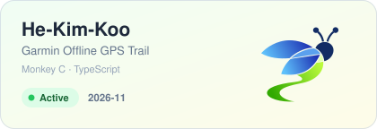
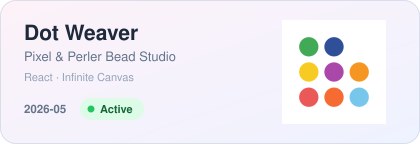
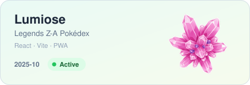
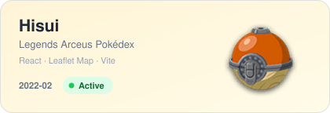
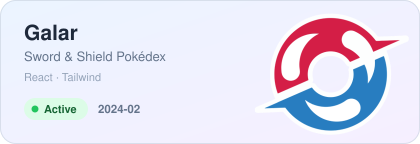
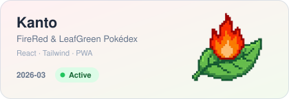
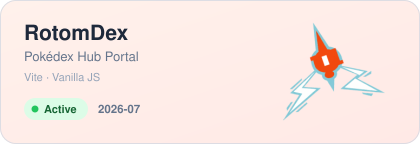
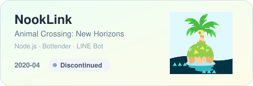

<h1 align="center">Hi 👋, I'm ShihChi</h1>
<h3 align="center">A passionate full-stack &amp; systems developer from Taiwan — building web apps, system tools, and playful side projects</h3>

  <code>Backend Architecture</code> · <code>System Design</code> · <code>Cloud System Design</code>

  By day, I design backend &amp; cloud systems; by night, I turn ideas into interactive web apps, desktop bridges, and playful tools.

  

  
  &nbsp;
  

---

<h2 align="center">🛠️ Hardware, Desktop &amp; Creative Tools</h2>

  
  &nbsp;
  

  
  &nbsp;
  

<h2 align="center">🎮 Pokédex &amp; Gaming</h2>

  A multi-generation Pokédex series — unified under <a href="https://huskyhsu.github.io/rotomdex/" target="_blank" rel="noopener noreferrer">RotomDex</a>.

  
  &nbsp;
  

  
  &nbsp;
  

  
  &nbsp;
  

  
  &nbsp;
  

---

📋 Project Directory (Repositories &amp; Live Links)

| Project            | Category             | Created |     Status      | Links                                                                                                                                                                                                    |
| :----------------- | :------------------- | :-----: | :-------------: | :------------------------------------------------------------------------------------------------------------------------------------------------------------------------------------------------------- |
| **Hé Kim Koo**     | Hardware & Desktop   | 2026-11 |    🟢 Active    | <a href="https://github.com/HuskyHsu/he-kim-koo" target="_blank" rel="noopener noreferrer">Repo</a> · <a href="https://huskyhsu.github.io/he-kim-koo/" target="_blank" rel="noopener noreferrer">Live</a> |
| **Ghost Pad**      | Hardware & Desktop   | 2026-10 |    🟢 Active    | <a href="https://github.com/HuskyHsu/ghost-pad" target="_blank" rel="noopener noreferrer">Repo</a>                                                                                                       |
| **RotomDex**       | Pokédex & Gaming     | 2026-07 |    🟢 Active    | <a href="https://github.com/HuskyHsu/rotomdex" target="_blank" rel="noopener noreferrer">Repo</a> · <a href="https://huskyhsu.github.io/rotomdex/" target="_blank" rel="noopener noreferrer">Live</a>     |
| **Somnus**         | Creative & Lifestyle | 2026-06 |    🟢 Active    | <a href="https://github.com/HuskyHsu/somnus" target="_blank" rel="noopener noreferrer">Repo</a> · <a href="https://huskyhsu.github.io/somnus/" target="_blank" rel="noopener noreferrer">Live</a>         |
| **Dot Weaver**     | Creative & Lifestyle | 2026-05 |    🟢 Active    | <a href="https://github.com/HuskyHsu/dot-weaver" target="_blank" rel="noopener noreferrer">Repo</a> · <a href="https://huskyhsu.github.io/dot-weaver/" target="_blank" rel="noopener noreferrer">Live</a> |
| **Kanto**          | Pokédex & Gaming     | 2026-03 |    🟢 Active    | <a href="https://github.com/HuskyHsu/kanto" target="_blank" rel="noopener noreferrer">Repo</a> · <a href="https://huskyhsu.github.io/kanto/" target="_blank" rel="noopener noreferrer">Live</a>           |
| **Lumiose**        | Pokédex & Gaming     | 2025-10 |    🟢 Active    | <a href="https://github.com/HuskyHsu/lumiose" target="_blank" rel="noopener noreferrer">Repo</a> · <a href="https://HuskyHsu.github.io/lumiose/" target="_blank" rel="noopener noreferrer">Live</a>       |
| **Galar**          | Pokédex & Gaming     | 2024-02 |    🟢 Active    | <a href="https://github.com/HuskyHsu/galar" target="_blank" rel="noopener noreferrer">Repo</a> · <a href="https://huskyhsu.github.io/galar/" target="_blank" rel="noopener noreferrer">Live</a>           |
| **SleePoke**       | Pokédex & Gaming     | 2023-07 | 🟡 Discontinued | <a href="https://github.com/HuskyHsu/sleepoke" target="_blank" rel="noopener noreferrer">Repo</a> · <a href="https://huskyhsu.github.io/sleepoke/" target="_blank" rel="noopener noreferrer">Live</a>     |
| **Paldea**         | Pokédex & Gaming     | 2022-11 |    🟢 Active    | <a href="https://github.com/HuskyHsu/paldea" target="_blank" rel="noopener noreferrer">Repo</a> · <a href="https://huskyhsu.github.io/paldea/" target="_blank" rel="noopener noreferrer">Live</a>         |
| **Hisui (Arceus)** | Pokédex & Gaming     | 2022-02 |    🟢 Active    | <a href="https://github.com/HuskyHsu/arceus" target="_blank" rel="noopener noreferrer">Repo</a> · <a href="https://huskyhsu.github.io/arceus/" target="_blank" rel="noopener noreferrer">Live</a>         |
| **NookLink**       | Pokédex & Gaming     | 2020-04 | 🟡 Discontinued | <a href="https://github.com/HuskyHsu/NookLink" target="_blank" rel="noopener noreferrer">Repo</a>                                                                                                        |

