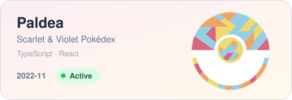
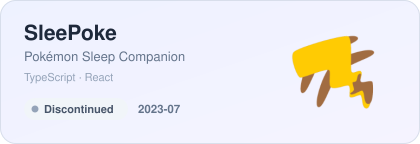
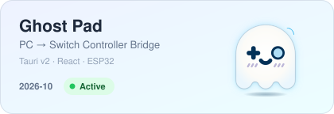
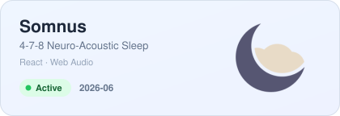

<h1 align="center">Hi 👋, I'm ShihChi</h1>
<h3 align="center">A passionate full-stack &amp; systems developer from Taiwan — building web apps, system tools, and playful side projects</h3>

  <code>Backend Architecture</code> · <code>System Design</code> · <code>Cloud System Design</code>

  
  &nbsp;
  

---

<h2 align="center">🎮 Pokédex &amp; Gaming</h2>

  
  &nbsp;
  
   
  
  &nbsp;
  
   
  
  &nbsp;
  
   
  
  &nbsp;
  

<h2 align="center">🛠️ Hardware, Desktop &amp; Creative Tools</h2>

  
  &nbsp;
  
   
  
  &nbsp;
  

---

📋 Project Directory (Repositories &amp; Live Links)

| Project            | Category             | Created |     Status      | Links                                                                                           |
| :----------------- | :------------------- | :-----: | :-------------: | :---------------------------------------------------------------------------------------------- |
| **Lumiose**        | Pokédex & Gaming     | 2025-10 |    🟢 Active    | [Repo](https://github.com/HuskyHsu/lumiose) · [Live](https://HuskyHsu.github.io/lumiose/)       |
| **Paldea**         | Pokédex & Gaming     | 2022-11 |    🟢 Active    | [Repo](https://github.com/HuskyHsu/paldea) · [Live](https://huskyhsu.github.io/paldea/)         |
| **Hisui (Arceus)** | Pokédex & Gaming     | 2022-02 |    🟢 Active    | [Repo](https://github.com/HuskyHsu/arceus) · [Live](https://huskyhsu.github.io/arceus/)         |
| **Galar**          | Pokédex & Gaming     | 2024-02 |    🟢 Active    | [Repo](https://github.com/HuskyHsu/galar) · [Live](https://huskyhsu.github.io/galar/)           |
| **Kanto**          | Pokédex & Gaming     | 2026-03 |    🟢 Active    | [Repo](https://github.com/HuskyHsu/kanto) · [Live](https://huskyhsu.github.io/kanto/)           |
| **RotomDex**       | Pokédex & Gaming     | 2026-07 |    🟢 Active    | [Repo](https://github.com/HuskyHsu/rotomdex) · [Live](https://huskyhsu.github.io/rotomdex/)     |
| **SleePoke**       | Pokédex & Gaming     | 2023-07 | 🟡 Discontinued | [Repo](https://github.com/HuskyHsu/sleepoke) · [Live](https://huskyhsu.github.io/sleepoke/)     |
| **NookLink**       | Pokédex & Gaming     | 2020-04 | 🟡 Discontinued | [Repo](https://github.com/HuskyHsu/NookLink)                                                    |
| **Ghost-Pad**      | Hardware & Desktop   | 2026-10 |    🟢 Active    | [Repo](https://github.com/HuskyHsu/ghost-pad)                                                   |
| **He-Kim-Koo**     | Hardware & Desktop   | 2026-11 |    🟢 Active    | [Repo](https://github.com/HuskyHsu/he-kim-koo) · [Live](https://huskyhsu.github.io/he-kim-koo/) |
| **Dot Weaver**     | Creative & Lifestyle | 2026-05 |    🟢 Active    | [Repo](https://github.com/HuskyHsu/dot-weaver) · [Live](https://huskyhsu.github.io/dot-weaver/) |
| **Somnus**         | Creative & Lifestyle | 2026-06 |    🟢 Active    | [Repo](https://github.com/HuskyHsu/somnus) · [Live](https://huskyhsu.github.io/somnus/)         |

